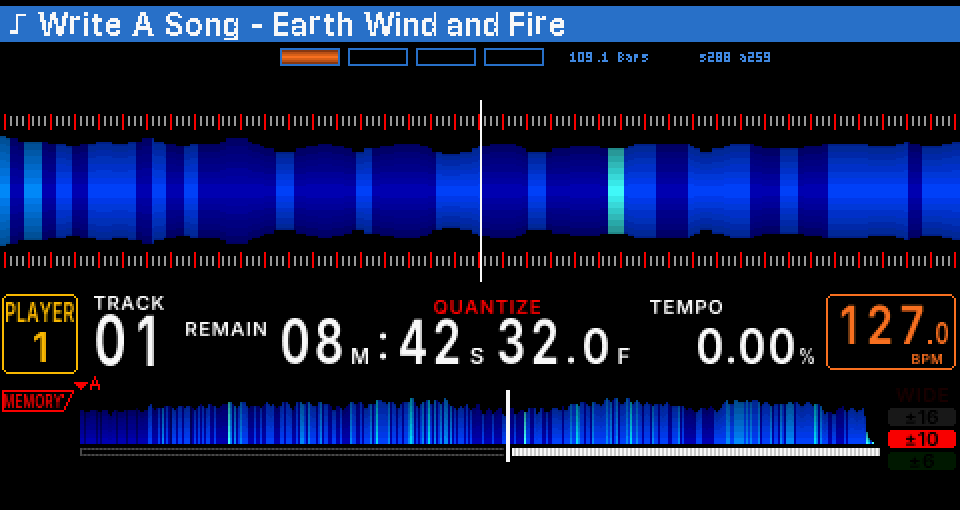
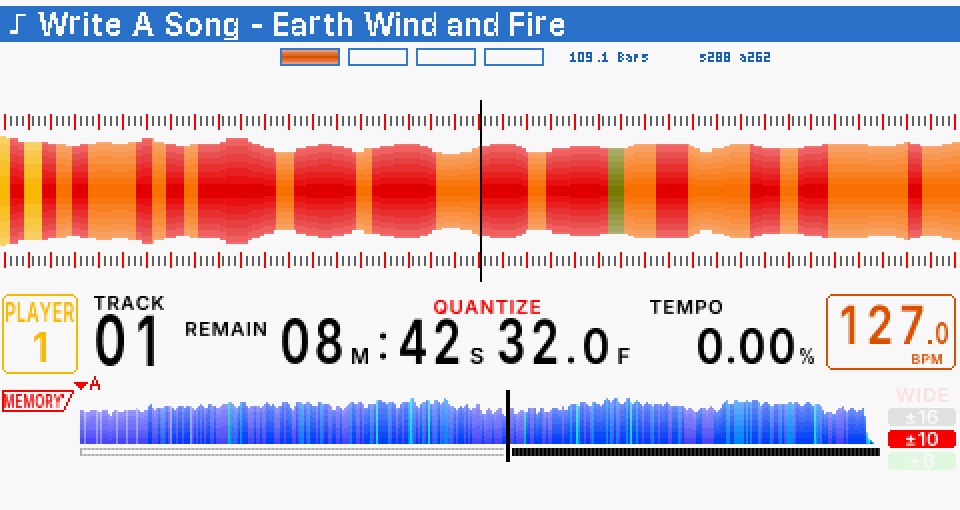
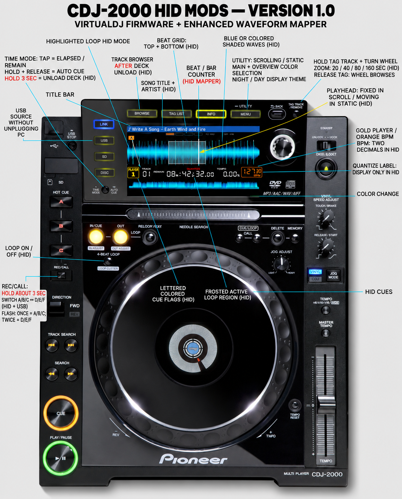
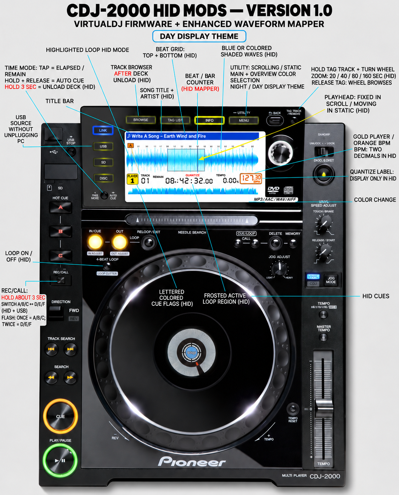

# CDJ-2000 HID MODS

Custom display firmware and an **Enhanced Waveform VirtualDJ mapper** for the
original **Pioneer CDJ-2000**. Working Version **1.0** combines blue/colored
scrolling waveforms, four zoom levels, six Hot Cues, beat-grid feedback, and
highlighted loops.

[Download Version 1.0](https://github.com/chrisdamonpoe-byte/CDJ-2000-HID-MODS/releases/tag/v1.0)
· [HID / USB feature list](features.md)
· [Screenshots and feature diagrams](docs/screenshots.md)

This is an unofficial project for the original CDJ-2000. Compatibility with
CDJ-2000NXS, NXS2, or other players is not established.

## Version 1.0 highlights

- **Scrolling or static main waveform**, selected in UTILITY.
- **Blue or colored shaded waveforms.** The current main wave clones the lower
  overview's contour and shading, enlarged and mirrored in the scrolling area.
- **Four scrolling zoom spans:** 20, 40, 80, and 160 seconds. Hold **TAG TRACK**
  and turn the browse wheel; release TAG to retain normal browser scrolling.
- **Six Hot Cues in two banks:** A/B/C and D/E/F, with REC/CALL bank switching
  and flashing bank confirmation. HID uses the mapper; standalone USB uses MAIN.
- **Lettered colored cue flags**, beat-grid ticks above and below the waveform,
  a beat/bar counter, and a frosted active-loop region in HID mode.
- **Title and artist from VirtualDJ**, two-decimal BPM, orange BPM graphics,
  gold PLAYER graphics, updated fonts, and **NIGHT / DAY themes**.
- **MENU / UTILITY access while LINK is active**, and return to USB without
  unplugging the laptop cable.
- **Three TIME_MODE actions in HID:** tap for elapsed/remaining time, hold and
  release for Auto Cue, or hold three seconds to unload the assigned deck.

See [features.md](features.md) for the complete mode-by-mode comparison. Native
USB features and the original mod's behavior are identified separately from
the HID additions.

## Waveform previews

### Night — blue clone



### Day — colored clone



These are firmware-emulator captures using test data. The annotated diagrams
below are illustrations of the controls, not exact firmware screen captures.

## Feature diagrams

The corrected diagrams retain the original player-and-callout style, update the
long-hold labels to the current mapper's **three-second** specification, and add
zoom, display-theme, grid, and cue-bank information. Earlier physical hold timing
varied; “about three seconds” is used for REC/CALL.

<a href="docs/images/features-night-v1.0.png"></a>

<a href="docs/images/features-day-v1.0.png"></a>

The [original supplied diagram](docs/images/features-original.png) is also
preserved. Its five-second annotations and eight-beat label are superseded by
the controls documented here: the current HID 4-BEAT LOOP mapping is **loop
on/off**, and the TIME_MODE unload timer is **3000 ms**.

## Download and install

Download the matched
[Working Version 1.0 ZIP](https://github.com/chrisdamonpoe-byte/CDJ-2000-HID-MODS/releases/download/v1.0/CDJ2000-Working-Version-1.0-2026-11-23.zip)
from the release. Read its `README-FIRST.txt` before installation.

```text
Install/
  Firmware/
    C2KMAIN.UPD
    C2KGUI.UPD
  Mapper/
    Pioneer CDJ-2000 - Enhanced Waveform.xml
```

1. Use **both firmware files from Install/Firmware** with your existing
   CDJ-2000 update procedure. Keep power on during the update and restart afterward.
2. Close VirtualDJ and replace the Enhanced Waveform mapper with the supplied
   file of the same name. Reopen VirtualDJ and use that mapper for each player.
3. Keep **both CDJs connected** during VirtualDJ tests; unplugging one changes
   deck assignment.
4. For the blue main wave, hold MENU to enter UTILITY, then choose
   **SCROLL COLOR → BLUE/GREEN**.
5. For the daytime display, choose **DISPLAY THEME → DAY** in UTILITY.

Use the matched MAIN, GUI, and mapper together. The ZIP includes a GUI-only
previous-look rollback and an earlier MAIN/GUI/mapper restore set; read the
package notes before choosing a rollback.

### Startup defaults

| Setting | Default after restart |
| --- | --- |
| LINK WAVEFORM | SCROLLING |
| SCROLL COLOR | COLORED |
| LINK OVERVIEW COLOR | BLUE |
| DISPLAY THEME | NIGHT |
| Scrolling zoom | 80 seconds |

Blue and Day must be selected again after restart; persistent storage of those
choices was not added.

## Matched component hashes

| Component | SHA-256 |
| --- | --- |
| MAIN | `41fabccb7ad781f35362ffc0b76622e28290cc0c4451cd9f071b36c9ce16e7ab` |
| GUI | `030b8c42b8022e13435581553264286a8369fe06724ba4c1096d8d5e8222ebac` |
| Mapper | `331f237f6b842e835efa4e8dfeef15e4eda2411c1743ec9a689e7b5ee9001a1b` |

The [package manifest](docs/package-sha256.json) also identifies the rollback
components and supporting files. These hashes identify the release files; they
do not establish what is installed on a particular player.

## Validation and current limits

The packaged validation records **58 emulator checks**, **2010/2010 packets**,
MAIN parser replay checks, and a whole-file GUI update-receive simulation.
See the [GUI log](docs/validation-gui.txt) and [MAIN log](docs/validation-main.txt).
“Working Version 1.0” names this matched set; a complete physical test of every
feature in both modes has not been recorded.

- The scrolling wave uses roughly **400 overview points per track**. Zoom and
  shading do not create new source detail or frequency-band information.
- The QUANTIZE label is **always lit in the eligible HID waveform view**. It
  does not turn quantization on or report VirtualDJ's live Quantize state.
- Instant recall of all six USB cues after loading is not established. A/D,
  B/E, and C/F share cache slots; changing within a pair can require reloading.
- Counter/grid synchronization and hold timing had earlier reported issues;
  emulator passes alone do not prove perfect physical timing.
- The six USB cues require exported rekordbox **Hot Cues**, not just Memory Cues.
- True detailed three-band streaming, visual frequency EQ, and live Quantize
  feedback are parked. They are not enabled by this release's clone GUI.

The base player/original mod supplies native USB functionality. This repository
documents the matched firmware, mapper, appearance, and controls of this version.
