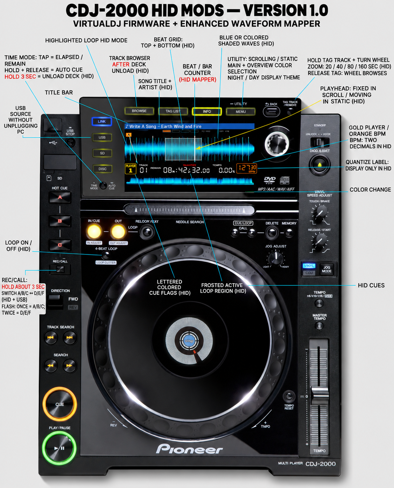
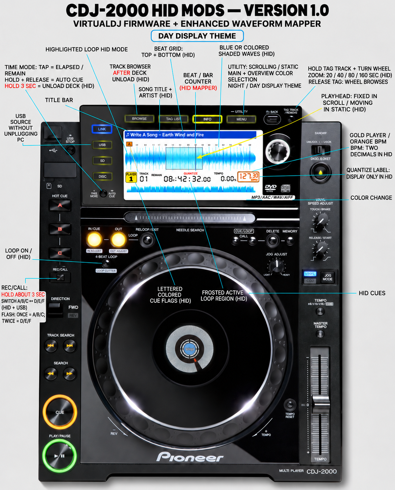
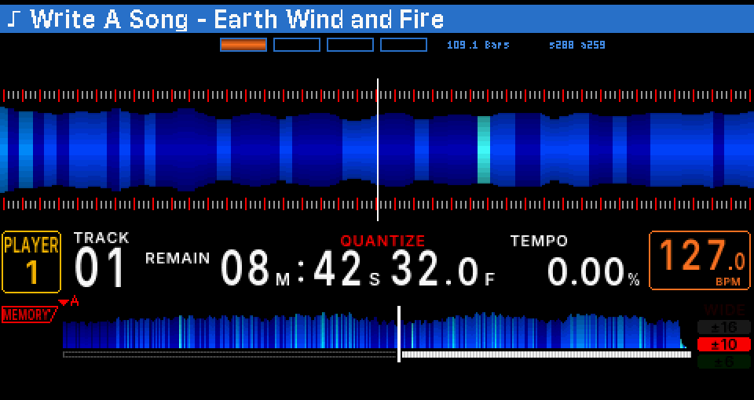
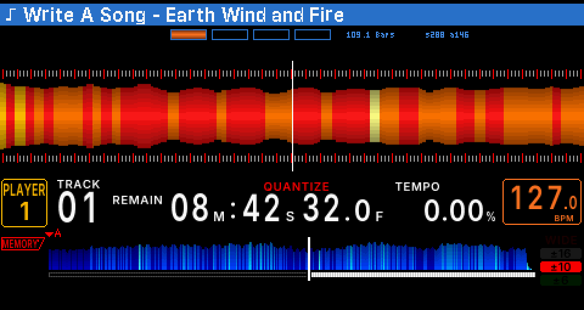
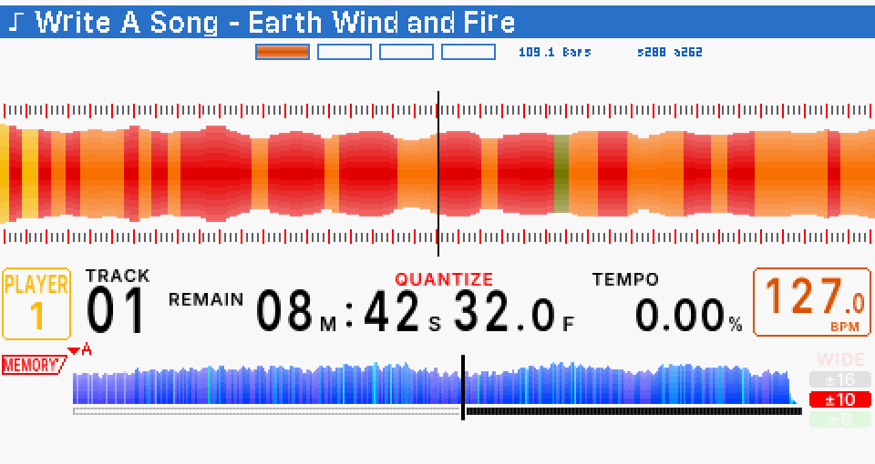

# Version 1.0 screenshots and feature diagrams

## Corrected control diagrams

These annotated illustrations retain the supplied player photograph's layout
and cyan leader-line style. Their screen graphics are illustrative; use the
emulator captures below for the actual Version 1.0 waveform appearance.

### Night

### Day

Day is the existing **UTILITY → DISPLAY THEME → DAY** display setting. It uses
a white display background; it does not change the player's hardware color.

### Corrections and additions

- TIME_MODE: tap for elapsed/remaining, hold-and-release for Auto Cue, hold
  three seconds for deck unload in HID.
- REC/CALL: hold about three seconds to change cue bank; once-flash for A/B/C,
  twice-flash for D/E/F.
- Physical 4-BEAT LOOP button: the current HID mapper toggles loop on/off.
- TAG TRACK + wheel: 20/40/80/160-second zoom; normal browsing when released.
- Main/lower color settings, SCROLLING/STATIC, NIGHT/DAY, mirrored grids,
  lettered cue flags, two-decimal HID BPM, and display-only QUANTIZE labeling.

The [original diagram](images/features-original.png) is preserved for reference;
its older five-second and eight-beat annotations are not the current control spec.

## Actual emulator captures

The following images use firmware test data, not a photograph of a playing CDJ.

### Blue clone — Night

### Colored clone — Night

### Colored clone — Day

The main scrolling clone remains mirrored; the lower overview remains one-sided.
Both use the reduced overview source. The upper and lower color settings are
independent. Day and color selections revert to their startup defaults after
restart; see the [README](../README.md) and [feature list](../features.md).
